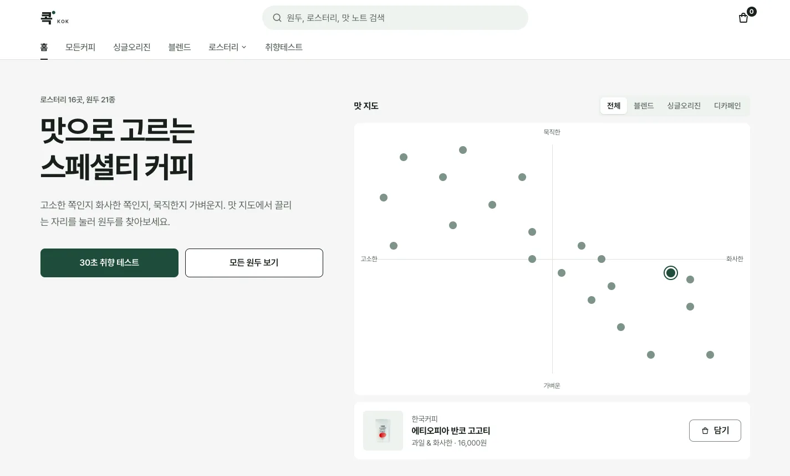
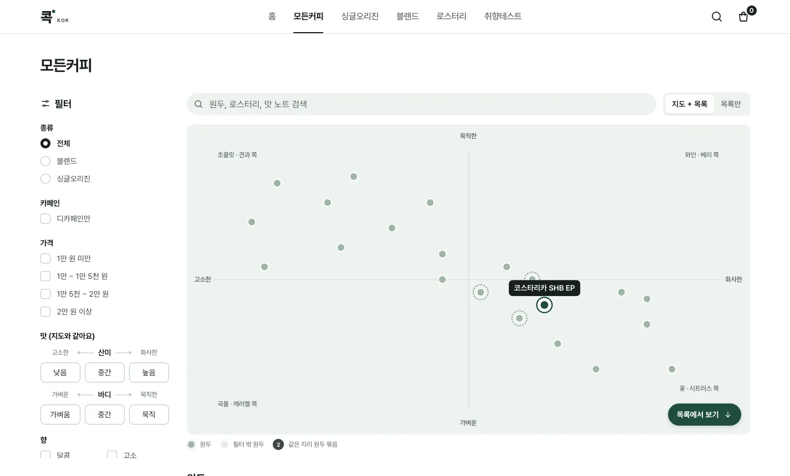

# 콕커피 (KOK COFFEE)

맛 지도에서 산미 · 바디로 원두를 고르는 커피 큐레이션 쇼핑몰입니다. 2022년에 HTML/jQuery와 React로 두 번 만든 쇼핑몰 「코케」를 브랜드 이름 「콕커피」로 바꿔 Next.js로 다시 만든 포트폴리오 리뉴얼이에요. 실제 판매 · 결제는 되지 않는 데모입니다.

**Live** — https://kok-coffee.vercel.app




## 주요 기능

- **맛 지도** — 원두 21종을 산미(고소한 ↔ 화사한) · 바디(가벼운 ↔ 묵직한) 좌표에 점으로 놓아요. 점을 누르면 아래 목록이 「고른 원두 → 맛이 가까운 순」으로 바뀌고, 가까운 원두 3개에 「맛이 비슷해요」 표시가 붙어요. 지도는 Tab 한 번으로 들어가 방향키로 점 사이를 옮겨요.
- **목록 필터** — 종류 · 카페인 · 가격 · 맛(산미 · 바디 버튼) · 향을 고르면 지도에 구간 상자가 생기고 맞지 않는 점은 흐려져요. 조건 · 보기 · 고른 점이 모두 주소(쿼리)에 남아 링크로 공유할 수 있어요.
- **30초 취향 테스트** — 질문 5개의 답으로 지도 위 「내 취향」 자리를 정하고, 그 자리와 가까운 원두 3개를 추천해요. 결과는 목록 지도에 핀으로 남고 「내 취향과 가까운 순」 정렬이 생겨요.
- **장바구니 · 주문서 데모** — 옵션(용량 · 분쇄) · 수량 · 되돌리기, 무료배송 막대, 칸마다 검사하는 주문서(첫 오류 칸으로 초점 이동), 주문 완료까지. 장바구니는 브라우저에 저장돼요.

## 사용 기술

- Next.js 16 (App Router) · React 19 · TypeScript
- Tailwind CSS v4
- Zustand (장바구니 · 취향 핀 · 주문 저장, `persist`)
- Vercel 배포
- 글꼴: Pretendard Variable (SIL OFL 1.1)

## 신경 쓴 점

- **접근성** — 모든 페이지 첫 초점에 「본문으로 건너뛰기」, `:focus-visible` 초점 테두리, 누르는 칸 최소 24px, 글자 대비 4.5:1 기준 점검, 폼 오류는 칸 바로 아래 아이콘 + 글(`aria-invalid` · `aria-describedby`), 화면 변화는 `aria-live`로 알림, 움직임 줄이기 설정이면 애니메이션을 멈춰요.
- **반응형** — 모바일 ≤640 · 태블릿 641–1023 · 웹 ≥1024, 폭 320까지 가로 스크롤 없이 보이는지 페이지마다 확인했어요. 1023px 이하에서 필터는 아래 시트로 열려요.
- **디자인 보드와 일치** — 디자인 보드(웹 1440 · 태블릿 768 · 모바일 390)와 요소 위치를 하나씩 재서 비교하며 맞췄어요.
- **글꼴 나누기** — 한글 웹폰트를 「사이트에 쓰인 글자」와 「나머지 2,350자」 두 파일로 나누고 `unicode-range`로 필요한 것만 받아요(`npm run font:subset`로 다시 만듦).
- **내용과 코드 분리** — 화면 글은 `src/content/`, 상품 · 로스터리 데이터는 `src/data/`에만 두고, 맛 좌표 · 구간 · 거리 계산은 `src/lib/taste.ts` 한 곳에서 해요.
- **색 고정** — 기기가 다크 모드여도 폼 · 스크롤바 색이 바뀌지 않게 `color-scheme: light`로 고정했어요.

## Lighthouse (모바일, 배포 주소 · 3번 잰 중간값)

| 페이지      | 성능 | 접근성 | 권장사항 | SEO |
| ----------- | ---- | ------ | -------- | --- |
| 메인        | 99   | 96     | 100      | 100 |
| 목록        | 91   | 100    | 100      | 92  |
| 상세        | 96   | 100    | 100      | 100 |
| 취향 테스트 | 100  | 100    | 100      | 100 |

## 실행 방법

```bash
npm install
cp .env.example .env.local   # NEXT_PUBLIC_SITE_URL에 사이트 주소(예: http://localhost:3000)를 적어요
npm run dev                  # http://localhost:3000
```

- `NEXT_PUBLIC_SITE_URL` — 공유 이미지 · sitemap · robots에 쓰는 사이트 주소 하나만 둬요(공개 값). 비우면 `http://localhost:3000`을 써요.
- 검사: `npx tsc --noEmit` · `npm run lint` · `npm run format:check` · `npm run build`

## 폴더

기획 · 디자인 과정은 포트폴리오(https://hyetico-portfolio-sigma.vercel.app)에서 볼 수 있어요.

```
src/
├─ app/          페이지 (메인 · 목록 · 상세 · 로스터리 · 취향 테스트 · 장바구니 · 주문서 · 주문 완료)
├─ components/   화면 조각 (ui · layout · list · taste-map · cart · checkout …)
├─ content/      화면에 보이는 글
├─ data/         상품 · 로스터리 데이터 (JSON)
├─ lib/          가격 · 필터 · 맛 지도 계산
└─ store/        장바구니 · 취향 핀 · 주문 (Zustand)
```

## 알려진 점

Lighthouse 모바일(배포 주소, 3번 잰 중간값)에서 남은 감점과 그대로 둔 이유예요.

- 장바구니 SEO 66 — 장바구니 · 주문서 · 주문 완료는 개인 화면이라 robots.txt로 검색에서 일부러 뺐어요(`is-crawlable` 감점).
- 목록 「소개 글 없음」 — 소개 글은 들어 있지만, 주소 쿼리(종류)로 제목을 정하는 페이지라 Next.js가 메타 태그를 본문 뒤에 보내 Lighthouse가 못 읽어요. 검색 로봇에는 처음부터 넣어 보내요.
- 메인 맛 지도 점 간격(`target-size`) — 좁은 화면에서 맛이 비슷한 점끼리 가까워요. 같은 원두를 목록 · 검색에서도 고를 수 있어 WCAG 2.5.8 예외(같은 기능을 하는 다른 방법)에 해당해요.
- 목록 TBT 305ms(「개선 필요」, 좋음 기준 200ms) — 처음 열 때 원두 21개의 지도 좌표 · 구간 · 묶음 계산과 지도 점 · 카드 그리기를 한꺼번에 해서 생겨요. 계산 저장(useMemo) · 안 보이는 카드 나중에 그리기 · 서버 컴포넌트로 옮기기로 줄일 수 있어요(다음 개선).
- 맛 점수(산미 · 바디)는 맛 노트를 보고 정한 임시값이에요. 실제 커핑 점수가 생기면 `src/data/products.json`의 `taste`만 바꾸면 지도 · 필터 · 테스트가 함께 바뀌어요.

## 자료 출처

- 상품 · 로스터리 이름 · 사진 · 맛 노트 · 가격은 2022년 원본 「코케」 사이트(kokewep · kokereact) 데이터예요.
- 이 사이트는 포트폴리오용 비영리 데모예요. 실제 판매 · 결제는 되지 않으며, 상품 정보 · 사진 · 로고의 권리는 각 로스터리에 있어요.
- 사업자 정보 · 연락처 · 매장 소개 글은 포트폴리오용 가상 값이에요.
- Pretendard — SIL Open Font License 1.1 (`src/app/fonts/LICENSE.txt`)
